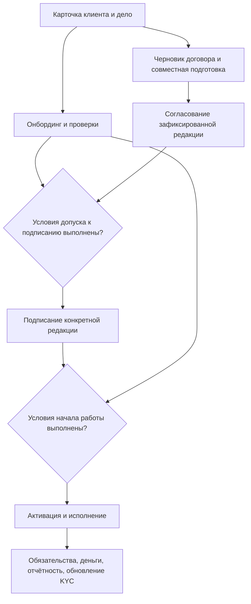

# Техническое задание: договоры и ежедневная работа с клиентами

**Проект:** Turan Capital Fund CRM / Golden Leaves Ltd

**Дата:** 28 октября 2026 года

**Версия ТЗ:** 1.18
**Основание:** предложение по развитию CRM и поручение владельца составить ТЗ и начать реализацию.

**Статус:** реализация по этапам; фактическое состояние отмечается в разделе 12.

## 1. Цель и результат

CRM должна сопровождать клиента от первого контакта до исполнения договора. Сотрудник видит ответственного, историю общения, текущий документ, ожидаемое решение и следующее действие. Руководитель видит задержки, обязательства и загрузку команды.

Уточнение владельца от 27.10.2026: для черновика достаточно карточки клиента; подготовка и согласование договора идут параллельно с онбордингом. Полная активация клиента не является предварительным условием подготовки договора. Связь всех разделов и проверки переходов описаны в разделах 13–15. Это требования к процессу CRM, а не заключение о нормативных требованиях.

Первая очередь: **шаблон Word → общий документ внутри CRM → одновременное редактирование участниками → фиксация редакции → согласование → подписание → поручения**. M1 включает хранение версий (M1A) и встроенный совместный редактор (M1B). Затем реализуются M2 и M3. Остальные очереди описаны как план развития, а не как уже реализованные функции.

**Обязательное уточнение владельца:** шаблон поступает в Word; участники процесса согласования должны редактировать документ прямо в CRM, одновременно, без обязательного скачивания и повторной загрузки. Редактор входит в первую очередь. Уже написанное хранение файлов — основа этой функции, но само по себе не выполняет требование совместной работы. Подробный сценарий и технические условия: [Совместный редактор договоров](TZ_CRM_Collaborative_Editor.md).

## 2. Исходное состояние

Подтверждено кодом на 27.10.2026:

- Express, SQLite (`node:sqlite`), JavaScript без сборки; запуск и тесты из `server`.
- `engagements`: реестр договоров, редактирование реквизитов, ссылок и финансовых полей. Интерфейс — `js/onboarding.js`.
- `ob_clients`, `ob_tasks`: клиенты и задачи onboarding; задачи имеют комментарии.
- `workflow_instances`: согласования KYC и публикации NAV. Другие решения представлены на общей странице согласований через собственные модули.
- Роли и права хранятся в БД; учитываются компания пользователя, режим «Только просмотр» и разделение CF&A/FM.
- Есть документы, аудит действий, календарь и механизм email-уведомлений.
- Текущее редактирование договора меняет карточку и ссылку. Неизменяемой истории файлов, привязки одобрения к редакции и встроенного редактора текста пока нет.

Существующие данные, KYC, инвестиционный комитет и финансовые процессы сохраняются. Новый договорный процесс расширяет реестр `engagements`.

## 3. Пользователи и правила доступа

| Участник | Действия |
|---|---|
| Менеджер / автор | Загрузить шаблон DOCX, создать договор по шаблону, работать с общим документом в CRM, пригласить участников, отправить редакцию на согласование |
| Назначенный согласующий | Одновременно с коллегами редактировать или предлагать правки согласно выданному доступу, комментировать пункты, принять решение по зафиксированной редакции |
| Руководитель | Настроить маршруты, контролировать сроки, назначить замену с записью в истории |
| Исполнитель | Выполнить поручение, записать результат, приложить документ |
| Аудитор | Читать доступные данные и скачивать файлы; изменения запрещены |

Общие ограничения:

1. Каждая новая таблица и каждый запрос ограничены `tenant_id` из серверной сессии.
2. Доступ к файлу и истории определяется доступом к договору и связанному клиенту. Закрытые FM-данные не становятся видны через прямую ссылку, поиск или список поручений.
3. Автор, время, номер версии и результат согласования определяются сервером.
4. В M1 загрузку выполняет внутренний пользователь с доступом к договору, кроме ролей «Только просмотр». Более узкие права на управление договором вводятся в M2.
5. В M2 используются отдельные права `manageContracts`, `manageContractRoutes`, `recordContractSignature`; согласование дополнительно требует назначения на текущий шаг. Пользовательские роли поддерживаются без проверки названия роли в интерфейсе.
6. Самосогласование в M2 по умолчанию запрещено. Изменение этого правила доступно только администратору маршрута и фиксируется в его версии.

## 4. M1 — шаблон Word, совместный редактор и версии

### 4.1. Сценарий

1. Сотрудник загружает шаблон Word (`.docx`) в библиотеку шаблонов либо как исходный документ конкретного договора.
2. При создании договора по шаблону CRM делает отдельную рабочую копию. Общий шаблон и другие договоры не изменяются.
3. По кнопке «Открыть документ» встроенный редактор открывается внутри CRM; скачивание не требуется.
4. Несколько приглашённых участников одновременно работают с одной копией: видят присутствие коллег, изменения, комментарии и исправления.
5. Изменения автоматически сохраняются. CRM различает отправку правок редактору и подтверждённое сохранение файла в своём хранилище.
6. Для формального одобрения создаётся неизменяемая редакция; её номер и результат согласования сохраняются в истории.
7. Скачивание DOCX/PDF остаётся дополнительной возможностью экспорта. Повторная ручная загрузка используется только при импорте внешней редакции и не является основным способом работы.

### 4.2. Требования

- Редактируемый формат первой очереди — `.docx`, максимум 20 МиБ. PDF сохраняется как приложение или подписанный экземпляр; не подменяет редактируемый Word. Старый `.doc` требует отдельной конвертации, не объявляется поддержанным редактором без проверки.
- Причина ручного импорта/фиксации редакции обязательна, от 1 до 2000 символов после удаления пробелов по краям. Автосохранение совместного черновика не требует комментария после каждой правки.
- Зафиксированная версия неизменяема: нет API замены или удаления её байтов и метаданных. Восстановление создаёт новую рабочую копию из выбранной версии внутри CRM, с пояснением и сохранением истории.
- Совместный рабочий документ изменяется между фиксациями. Каждое нажатие клавиши и каждое автосохранение не создают отдельную формальную версию договора.
- Нумерация серверная, уникальна в пределах договора. Запрос содержит `expectedVersion`; устаревший номер возвращает 409. Двойное нажатие не создаёт две редакции.
- Повторная загрузка тех же байтов при неизменных реквизитах не создаёт новую версию и возвращает понятное сообщение.
- Вместе с файлом сохраняется снимок основных реквизитов карточки. Это сведения из CRM на момент загрузки, а не результат извлечения данных из документа.
- Если реквизиты карточки после загрузки изменились, интерфейс сообщает об этом. Загрузка новой версии может содержать те же байты, если снимок реквизитов изменился.
- Существующая ссылка не импортируется автоматически и остаётся отдельно обозначенной прежней ссылкой. Система не скачивает внешние адреса от имени пользователя.
- Удаление договора с историей версий запрещено. Для прекращённых договоров используется существующий статус `Terminated`.
- Перенос договора с версиями между клиентами или направлениями запрещён в обычном редактировании. Это сохраняет границы доступа и смысл истории.
- Успешная загрузка записывается в общий аудит. История сохраняет имя и email автора на момент действия.
- Сбой загрузки не меняет текущую редакцию; файл и запись сохраняются одной транзакцией. Сбой сохранения редактора явно отображается и блокирует формальное одобрение до восстановления сохранения.
- Правила совместного редактирования, доступа к исправлениям, завершения сессии и фиксации редакции обязательны по [дополнению M1B](TZ_CRM_Collaborative_Editor.md).

### 4.3. Данные и API

Таблица хранения неизменяемых редакций M1A `engagement_document_versions` (уже добавлена в код):

| Поле | Назначение |
|---|---|
| `id`, `tenant_id`, `engagement_id` | Идентификатор, компания, договор |
| `version_number` | Последовательный номер; UNIQUE(tenant_id, engagement_id, version_number) |
| `original_name`, `mime_type`, `size_bytes` | Сведения о файле |
| `sha256`, `file_bytes` | Контрольная сумма и неизменяемые байты |
| `change_note`, `metadata_json` | Причина и снимок реквизитов |
| `created_by`, `author_name`, `author_email`, `created_at` | Автор и серверное время UTC |

В M1A байты хранятся в SQLite: транзакция и существующий backup включают одновременно файл и историю. Это увеличивает размер БД и резервных копий; перед массовым импортом больших архивов необходимо измерить объём и предусмотреть перенос байтов в закрытое объектное хранилище с согласованным резервным копированием. Массовый импорт не входит в M1. Для M1B дополнительно требуются библиотека шаблонов, общий черновик, участники и сеансы редактора; их проектная модель приведена в дополнении.

| Метод и адрес | Результат |
|---|---|
| GET `/api/engagements/:id/versions` | История без байтов, текущий номер, наличие права загрузки, признак изменения реквизитов |
| POST `/api/engagements/:id/versions` | Multipart: `file`, `changeNote`, `expectedVersion`; новая версия |
| GET `/api/engagements/:id/versions/:versionId/file` | Скачивание файла с Bearer-авторизацией и повторной проверкой доступа |

Ошибки: 400 — поля/формат; 401 — сессия; 403 — права; 404 — чужая или отсутствующая сущность; 409 — конфликт версии/дубликат/запрещённое изменение истории; 413 — размер. Токены не передаются в URL. Серверные файлы и БД не должны раздаваться как статические ресурсы сайта.

### 4.4. Приёмка основы хранения M1A

- [x] Две разные редакции создают версии 1 и 2, обе скачиваются с исходными байтами.
- [ ] Перезагрузка страницы сохраняет историю и показывает последнюю редакцию.
- [x] Автор, время и номер не могут быть подменены полями запроса.
- [x] Чужая компания, внешний пользователь, пользователь без FM-доступа и деактивированная учётная запись не получают закрытый файл.
- [x] Аудитор читает и скачивает, но не загружает.
- [x] Ошибка, пустой/слишком большой файл, дубликат и устаревший номер не создают лишних записей.
- [x] Изменение реквизитов отражается в API; снимок старой версии сохраняется.
- [x] Договор с версиями нельзя удалить или перепривязать к другому клиенту/направлению.
- [x] Прежние ссылки и работа финансовых полей сохранены; новые файлы недоступны через статический сервер.
- [ ] API-тесты и визуальная проверка карточки пройдены.

### 4.5. Приёмка совместной работы M1B

- [ ] Из загруженного DOCX-шаблона создаётся независимый договор, открывающийся внутри CRM.
- [ ] Минимум три разных сотрудника в независимых браузерных сессиях одновременно меняют один документ и видят изменения друг друга.
- [ ] Отрабатывают комментарии к фрагментам, исправления с авторством, принятие/отклонение правок по правам.
- [ ] Сохранены таблицы, колонтитулы, нумерация, подписи и основные стили реальных шаблонов.
- [ ] После закрытия редактора всеми участниками и повторного открытия правки сохраняются.
- [ ] Разрыв связи, недоступный сервер редактора, повторный/запоздалый callback и отзыв доступа не приводят к потере подтверждённой версии или ложному одобрению.
- [ ] Смена текста после одобрения приводит к новой редакции и повторному согласованию; прежнее одобрение не переносится.

M1 считается завершённым только после M1A и M1B. Одни API-тесты хранения документов не подтверждают работоспособность совместного редактора.

## 5. M2 — согласование и фиксация подписания

Фактическое состояние: M2.1 (формальные решения по неизменяемому файлу) и M2.2 (регистрация подписания и серверная проверка начала работы, раздел 28) реализованы. Инструкция и ограничения текущей реализации — в разделе 16. Подготовка общего документа в редакторе M1B остаётся отдельной обязательной частью поставки.

### 5.1. Состояния

У договорного процесса отдельный статус, не подменяющий существующий статус оказания услуги:

`Черновик → Совместная доработка → На согласовании зафиксированной редакции → Согласован → На подписании → Подписан`.

Из «На согласовании» доступны «На доработке», «Отклонён», «Отозван». Повторная подача создаёт новый цикл, старые решения сохраняются. Новая редакция после согласования требует нового цикла. Подписанная редакция неизменяема; изменения после подписания оформляются связанным дополнительным соглашением.

### 5.2. Маршруты и решения

- Уточнение владельца от 27.10.2026: в карточке выбираются имена согласующих, и документ отправляется всем одновременно. Переключателя «параллельно / последовательно» и обязательной настройки маршрутов в интерфейсе нет. Для результата «Согласован» нужны одобрения всех выбранных участников. Уже начатые последовательные циклы сохраняют прежние правила до завершения или отзыва.
- Администратор задаёт название, тип договора, участников/роли, срок каждого шага и правило самосогласования.
- При подаче сервер фиксирует версию файла, снимок реквизитов и копию маршрута. Последующее редактирование шаблона не меняет начатый цикл.
- Роль разрешается в конкретного активного сотрудника при назначении. Отсутствие подходящего сотрудника блокирует подачу с объяснением.
- На шаге доступны «Согласовать», «Вернуть на доработку», «Отклонить». Для двух последних действий комментарий обязателен.
- Решение может принять только текущий назначенный сотрудник с актуальными правами. Повторный запрос не создаёт повторного решения.
- Во время совместной доработки участники одновременно редактируют документ согласно своим правам. Для подачи на формальное решение сервер прекращает запись в эту рабочую сессию, дожидается подтверждённого сохранения и фиксирует редакцию. Недостаточно просто скрыть кнопку редактирования в интерфейсе.
- Если после подачи требуется правка, действие «Продолжить доработку» возвращает документ в совместное редактирование и закрывает текущий цикл как требующий повторного согласования. Решения остаются привязаны к прежней редакции; новая редакция не наследует их. Изменение существенных реквизитов подчиняется тому же правилу.
- После возврата новая подача всегда создаёт новый цикл. Автор видит замечания и результаты прежних циклов.
- Замена согласующего, отзыв и повторная подача отражаются в истории; решения не редактируются задним числом.
- Новый цикл создаёт поручение согласующему; возврат — поручение автору; завершение или отзыв закрывают связанные поручения.

### 5.3. Подписание

В первой реализации сотрудник с правом `recordContractSignature` загружает подписанный PDF и указывает дату подписания. PDF связывается с одобренной версией и хранится отдельно как подтверждение. Это ручная регистрация подписания, а не электронная подпись системы. Автоматическая проверка соответствия текста скана согласованной редакции не заявляется.

Приёмка: изменение файла или существенного условия никогда не наследует одобрение прежней версии; чужой/завершённый шаг нельзя принять; весь цикл восстанавливается из истории; прямой API-запрос не обходит процесс.

## 6. M3 — «Моя работа» и контроль сроков

Фактическое состояние на 28.10.2026: часть требований закрыта разделом «Задачи» (разделы 23–33): срок, ответственный, состояния «В работе / Завершённые / Корзина», «Просрочено» и «Срок сегодня», ежедневное письмо о сроках, журнал изменений срока и ответственного. Что ещё не сделано — в разделе 12.

- Страница с разделами «На согласовании у меня», «На доработке», «Мои поручения», «Просрочено».
- Карточка поручения: название, исполнитель, постановщик, срок, приоритет, клиент/договор, состояние, обсуждение, результат.
- Обычные поручения: позвонить, подготовить предложение, запросить документы, проверить оплату. Статусы: открыто, в работе, выполнено, отменено.
- Завершение требует результата; отмена — причины. Переназначение и изменение срока записываются в историю.
- Фильтры: срок, исполнитель, клиент, тип и состояние. Руководитель видит команду в пределах своих прав.
- Системные поручения по согласованию нельзя вручную завершить в обход решения по документу.
- Напоминания используют существующий механизм уведомлений и защиту от повторов. Уведомления внутри CRM работают без SMTP; email используется при настроенной доставке.
- Даты хранятся однозначно, время — в UTC; пользователю показывается локальное время. Срок-дата не сдвигается при смене часового пояса.

Приёмка: одобрение переводит поручение следующему участнику; возврат создаёт задачу автору; завершённые решения исчезают из ожидающих; закрытые FM-клиенты не раскрываются через названия поручений или уведомления.

## 7. Следующие очереди

| Этап | Содержание | Проверяемый результат |
|---|---|---|
| M4. Клиент и контакты | Несколько контактных лиц, роли в компании, телефоны/email, ответственный; лента встреч, звонков, заметок и событий договора | Из карточки клиента видно, с кем и о чём общались, какие договорённости и следующий шаг |
| M5. Коммерческие возможности | Отдельные воронки CF&A и привлечения LP; источник, сумма/валюта, этап, ожидаемая дата, причина отказа | Возможность проходит этапы, связывается с существующим клиентом/onboarding/договором без дубликатов |
| M6. Обязательства | Этапы услуг, результаты, сроки, продление, уведомление о прекращении, связь со счетами и оплатами | По подписанному договору видны предстоящие и просроченные обязательства, создаются напоминания |
| M7. Автоматизация документов | Автоподстановка проверенных реквизитов в уже существующие шаблоны M1B, проверка незаполненных полей, расширенное сравнение редакций | Договор заполняется данными карточки; изменения можно сопоставить |
| M8. Интеграции | Почта, календарь, электронная подпись | Отдельное ТЗ на выбранные сервисы, права доступа, хранение и синхронизацию; готовность подтверждается реальными сценариями |

Перед M4–M8 требования детализируются по реальным рабочим примерам. Сроки и стоимость внешних интеграций определяются после выбора сервиса; подписки и внешние подключения не входят в текущую локальную реализацию.

## 8. Интерфейс

- Сохранить русский язык и существующий стиль CRM.
- В реестре показывать наличие версий; карточка содержит блок истории с ясным обозначением последнего файла.
- Загрузка имеет состояние ожидания, блокировку повторной отправки, видимый результат и объяснение ошибки.
- При конфликте версии выбор файла и причина сохраняются; пользователь получает возможность обновить историю и проверить актуальную редакцию.
- Все введённые имена файлов, комментарии и имена сотрудников экранируются.
- Не выдавать «сохранено», «согласовано» или «подписано» до подтверждения сервера.
- Встроенный редактор, сравнение текста и ЭЦП не обозначаются как действующие функции до реализации.

## 9. Техническая реализация

- Миграции совместимы с существующей БД и повторным запуском. Никакой очистки и повторного заполнения рабочей БД.
- Новый код договорных документов выделить в `server/contractDocuments.js` и `js/contract-documents.js`; интеграция с существующей карточкой остаётся небольшой.
- M2: отдельные сущности циклов, шагов и решений с внешними ключами на договор и неизменяемую версию. Исторические KYC-маршруты не менять.
- M3: таблица поручений с необязательной связью на договор/клиента/шаг; независимый API с проверкой доступа к связанной сущности.
- M1A использует имеющиеся зависимости. Для M1B нужен сервер совместного редактирования. Подтверждено наличие работающего Nextcloud; установленный в нём редактор пока неизвестен. В первую очередь проверяется существующий сервис. Предварительный вариант при его отсутствии — ONLYOFFICE Docs. На данный момент редактор к CRM не подключён.
- Для проверки использовать временную БД. Рабочие документы и клиенты не изменяются тестами.

## 10. Проверки и выпуск

Для каждого этапа: сценарии успешной работы, ошибки, права, разделение компаний и CF&A/FM, конкурирующие изменения, повторные запросы, сохранение после перезапуска, интерфейс на обычной и узкой ширине.

После целевых тестов — существующий набор `npm test`. Фактический результат фиксируется в журнале изменений. Публикация и Git push выполняются отдельным действием по поручению владельца; подготовка и локальная проверка уже входят в эту задачу.

## 11. Условия завершения первой очереди

Первая очередь завершена, когда M1A, M1B, M2 и M3 приняты: Word-шаблон превращается в отдельный договор, участники одновременно редактируют его внутри CRM без обязательного скачивания, договор имеет историю редакций, одобрение связано с конкретной редакцией, возвраты и подписание прослеживаются, сотрудники получают актуальные поручения, а проверки доступа и переходов выполняются сервером.

## 12. Ход реализации

| Этап | Состояние | Примечание |
|---|---|---|
| ТЗ 1.2 | Уточнено по требованию владельца | Word и совместное редактирование — первая очередь; черновики до активации клиента; оценка всех разделов и общая схема процессов |
| M1A | Основа хранения реализована; визуальная приёмка открыта | 12 API-тестов хранения, доступа и неизменяемой истории |
| M1B — библиотека | Реализована локально; визуальная приёмка открыта | DOCX-шаблоны, история редакций, архив/восстановление, отдельное право управления, независимые договоры из выбранной редакции; 10 новых API-тестов |
| M1B — совместный редактор | Следующий этап; подготовлено техническое дополнение | Требуются конфигурация существующего редактора Nextcloud, рабочий документ и сессии участников. Редактор ещё не подключён |
| M2.1 — согласование | Реализовано локально | Выбор имён в карточке, одновременное рассмотрение, одобрение всеми, неизменяемая редакция, сроки, возврат, отзыв, доработка и очередь договоров |
| M2.2 — подписание | Реализовано локально | Подписанный обеими сторонами PDF к согласованной редакции, дата подписания, команда «Начать работу» с проверкой подписи, KYC (2.2) и конфликта интересов (1.1); раздел 28 |
| Связь клиента и черновиков | Реализована локально | Клиенты CF&A до активации доступны для создания договора; карточки клиента и договора связаны переходами; состояние задач читается с сервера. Согласование не активирует клиента |
| Раздел «Задачи» (разделы 17–31) | Реализован локально | Общая переписка, свободные задачи и задачи договоров, связи с процессами CRM, вложения, ответственный, срок, завершение, корзина, переименование, окончательное удаление, непрочитанные, «Следующий шаг», массовое завершение и корзина. Закрывает часть M3 |
| M3 — «Моя работа» | В основном реализован | Сделано: «Мои задачи» с состояниями, сроками и ответственным; быстрые фильтры «Жду моего решения», «На доработке», «Просрочено», «Срок сегодня»; фильтры по ответственному и клиенту; обязательный результат при завершении; возврат договора автору (ответственный и письмо); счётчик в меню и ежедневное письмо о сроках (разделы 33, 36). Не сделано: приоритет, обзор задач команды для руководителя, отдельный статус «Отменена» с причиной (сейчас — корзина). Решения KYC/NAV и конфликтов остаются на странице «Согласования» |
| P0 — целостность процессов | В основном реализован | Сделано: активация клиента по явно выбранному договору (раздел 28); доступ к согласованиям KYC/NAV (раздел 32); связи решений по конфликтам (раздел 34); отчёт по старым данным (раздел 35); порядок этапов онбординга и активация на сервере (раздел 37); этап 4.1 CF&A — договор с клиентом, заключение 2.2 — MLRO (раздел 38) |
| M4–M8 | План развития | Детализация перед соответствующей очередью. Ближайший кандидат — M6 «Исполнение и оплата»: ждёт ответов владельца (где выставляются счета, кто подтверждает оплату, связь FM-договора с Capital Calls) |

Состояние на 28.10.2026 (ТЗ 1.18). Первая очередь не закрыта: открыт совместный редактор M1B (нужен сервер Nextcloud/ONLYOFFICE) и небольшой остаток M3; визуальная приёмка M1A и библиотеки шаблонов ждёт владельца. Ограничения M2.2 (раздел 28): срок актуальности KYC не проверяется, выполнение условий «Approved with conditions» по конфликту не отслеживается.

Проверка 27.10.2026 после добавления библиотеки: `npm.cmd test -- --test-concurrency=2` из `server`, 339 тестов, 0 ошибок. Из них 22 — хранение договоров и шаблоны: независимость копий, повторные и одновременные запросы, архив, права, границы компаний и FM. Проверки использовали отдельные тестовые БД. Повторная миграция сохраняет версии, байты и отозванные права. Рабочая БД не мигрировалась и рабочий сервер не перезапускался в ходе этой задачи; новая схема применится при следующем запуске обновлённого сервера.

Для завершения визуальной приёмки M1A: открыть «Реестр договоров», проверить пустую историю, загрузить две тестовые редакции, скачать обе, раскрыть снимок реквизитов, перезагрузить карточку и проверить её на узком экране. Проверить также ошибку дубликата: выбранный файл и причина должны сохраниться. Для завершения M1B требуется отдельная проверка реального редактора минимум тремя участниками; до неё M1 не закрывать.

Последующее обновление 27.10.2026 по просьбе владельца открыть результат: локальный сервер запущен на `http://localhost:4000/index.html`, миграции применены к локальной базе. До запуска сохранена и проверена резервная копия `server/data/backups/pre-contract-templates-2026-10-27T11-51-40-187Z.sqlite` (`quick_check: ok`). Страница CRM и скрипт библиотеки отвечают HTTP 200; API шаблонов без авторизации возвращает 401. Это проверка доступности, а не визуальная приёмка. Рабочие учётные записи и пароли не изменялись.

## 13. Оценка разделов CRM и их связей

Проверка связи с онбордингом 27.10.2026: 341/341 тестов, включая 24 теста договорных документов, шаблонов и связи с клиентом. Локальный сервер обновлён после резервной копии `server/data/backups/pre-process-links-2026-10-27T12-17-12-849Z.sqlite` (`quick_check: ok`). Обновлённые файлы интерфейса выдаются сервером. Это не завершает визуальную приёмку или реализацию формальных согласований.

Проверено по `index.html`, `js/app.js`, `js/onboarding.js`, `js/workflow.js`, `js/modules.js`, `server/index.js`, `server/wfDefinitions.js`, модели БД и маршрутам документов. Ниже отделено существующее поведение от предлагаемого. Правила бизнеса и регуляторные сроки не считаются подтверждёнными только потому, что они уже написаны в интерфейсе.

### 13.1. Главные выводы

1. CRM уже содержит несколько работающих механизмов решений: KYC, конфликты, IC, финансовые подтверждения, публикация NAV. Страница «Согласования» уже собирает часть ожидающих решений, но не является единым механизмом их исполнения. Её следует расширять, сохраняя предметные правила каждого модуля.
2. Устранён цикл «сначала активировать клиента → создать договор», хотя подготовка документа находится внутри онбординга. Теперь черновик CF&A создаётся до активации; создание не завершает ни одну задачу клиента.
3. В шаге CF&A 4.1 есть смысловое расхождение: название/`formKey` указывают на Engagement Letter, форма — на Term Sheet, а результат создаёт запись в общем реестре договоров. В новой модели это разные типы документов и, при необходимости, разные процессы. Нельзя автоматически считать подписанный Term Sheet подписанным Engagement Letter. *Решение владельца 28.10.2026: этап 4.1 CF&A — один документ, договор с клиентом (раздел 38).*
4. Активация CF&A сейчас находит первый договор клиента через `engagements.find(...)`. При нескольких документах требуется явная связь по ID с договором, на основании которого активируется обслуживание. Привязка по имени или первому совпадению должна быть заменена. *Исправлено в v1.59.0: этап 5.1 требует явно выбранный договор нужного направления (раздел 28).*
5. Часть переходов онбординга пока выполняется в браузере; API принимает обновления карточки/задачи без единого серверного расчёта готовности. Действующий интерфейс допускает `escalated` в числе завершённых задач активации. В новом процессе эскалация означает ожидание решения, а не разрешение продолжать. *Исправлено 28.10.2026: порядок этапов и активацию проверяет сервер (раздел 37).*
6. Общее поле `engagements.status` описывает обслуживание; оно не является доказательством согласования текста или подписания. Дата создания договора также не равна дате подписи — это уже разделено в карточке.
7. Перед расширением общей очереди необходима проверка доступа к родительской сущности во всех адаптерах. У существующих `/api/workflow` проверяется компания, но список не фильтруется по FM, а создание принимает ссылку на объект без полноценной проверки родителя. Такие ссылки нельзя использовать как основание автоматического допуска. Аналогично требуется проверить связи в конфликтах. *Исправлено 28.10.2026: `/api/workflow` — раздел 32, связи в конфликтах — раздел 34.*
8. Текущий KYC Renewal для CF&A использует дату начала клиента и признак активации как приближение. Для нового процесса нужны дата действительного решения, срок его актуальности и ссылка на подтверждающие материалы.

### 13.2. Карта всех разделов

| Раздел | Что уже есть | Как связать с общим процессом |
|---|---|---|
| Дашборд | Сводки и переходы к этапам | Показывать ожидающие решения, задержки и конкретную причину остановки; переход к исходной задаче |
| Сравнение фондов / выбор фонда | Представление данных по фондам | Ограничивать контекст дел фондом; сравнение остаётся аналитикой, не отдельным согласованием |
| Клиенты / Онбординг | Карточка, 7 задач, формы проверок, активация | Основное досье клиента; подготовка договоров параллельно; готовность рассчитывается на сервере |
| Реестр договоров | Карточки, финансовые поля, версии файлов | Отдельный цикл согласования редакции, подпись, обязательства; связь с клиентом и предметом сделки |
| Шаблоны Word | Версии DOCX, архив, копирование | Источник документа. Изменение шаблона не меняет договор и не аннулирует его решения |
| Согласования | KYC/NAV и сводная очередь IC, CC, AML, конфликтов, отчётности | Общий вход: «Мне решить», «На доработке», «Ждём других», «Просрочено»; действие направляется в соответствующий модуль |
| Restricted List / COI | Ограничения и регистрация конфликтов | Сигнал проверки и отдельное решение по конкретному клиенту/делу; совпадение не трактуется как готовое одобрение |
| Конфликты / Одобрения | Тип решения, риск, эскалация, участник с правом решения | Условия решения должны иметь исполнителя, срок и подтверждение; unresolved/условия не выполнены — явная причина остановки соответствующего перехода |
| KYC Renewal | Календарь обновлений, запуск KYC-цепочки | Новый цикл проверки с собственным результатом и сроком действия; старые решения сохраняются; ограничения новых действий определяются политикой |
| Compliance Calendar | Сроки отчётности и подтверждение отправки | Задачи подготовки, проверки и подачи отчёта; документ и квитанция связаны с периодом/фондом |
| LP Register | Инвесторы и связь с онбордингом | Создание активного LP после нужных проверок и подписания соответствующих документов; единый ID клиента, связь LP с фондом |
| Capital Calls | Черновик, право отправки, подтверждение оплаты и AML | Три самостоятельных результата: разрешение отправить notice, факт поступления денег, AML/SoF. Ни один не заменяет остальные |
| Distributions | Расчёт распределения, отправка, подтверждение выплат | Согласование расчёта по снимку условий и отдельное подтверждение каждой выплаты; отмена/исправление через отдельное событие |
| First Closing | Карточка условий/этапов закрытия | Вычисляемая готовность по LP, документам, commitments и подтверждённым взносам; итоговое решение закрытия хранит основания |
| HF — Подписки / Погашения | Заявки, статусы и финансовые операции | Отдельные маршруты подписки и погашения с KYC, условиями фонда, датами, опубликованным NAV и подтверждением денег |
| HF — NAV | Цепочка CFO → CEO; сервер проверяет одобрение перед публикацией | Сохранить существующую цепочку; добавить версию расчёта и недействительность прежнего одобрения после изменения исходных цифр |
| Investment Committee | Голосование мест комитета и Risk veto | Сохранить кворум/вето; связывать решение с версией memo и условиями инвестиции, а исполнение условий — с задачами сделки |
| Песочница | Проекты, файлы, задачи, перевод в скрининг | При переводе создавать связанную сделку, сохранять происхождение; внутренние исследовательские задачи не считать решениями IC |
| Сделки / Pipeline | DD, заключение УК, IC, стадии, подписанные документы | Досье инвестиционной сделки; изменения существенных условий требуют повторной проверки; договоры SHA/SPA связаны со сделкой, а не только названием клиента |
| Портфель | Компания, инвестиции, раунды, отчётность | Получает результат закрытой сделки; новые раунды, изменения и выходы создают самостоятельные процессы с документами и основаниями |
| SPV | Структура, инвесторы, взносы/распределения | Отдельное досье SPV, связь с компанией/сделкой; предметные правила денег сохраняются, права и доказательства проверяются отдельным адаптером |
| Документы | Реестр и связи с объектами | Метаданные документа и ссылка на конкретную версию; назначение «KYC/договор/решение/подпись», срок действия и доступ от родителя |
| Хранилище файлов | Физические файлы и загрузки | Одно защищённое хранилище подтверждающих файлов; хранение байтов не приравнивается к одобрению. Общие FM-файлы не становятся доступны CF&A |
| Экспорт Excel | Выгрузка представлений | Экспортировать статус и дату среза с теми же ограничениями доступа; импорт/экспорт не должен обходить решения |
| Команда / Пользователи / Роли | Ролевые права и отключение доступа | Назначать конкретного согласующего, замещение и сроки; отзыв доступа действует на открытый документ и ожидающее решение |
| Журнал изменений | События по модулям | Единая хронология дела с инициатором, версией объекта, решением и основанием; история не редактируется задним числом |
| Подписка | Демонстрационная тарифная страница | Не включать в согласование клиентских договоров. Будущий биллинг CRM — отдельный административный процесс |
| Порталы клиента / LP | Внешние кабинеты, загрузки и заявки | Внешний участник передаёт сведения/документы; это создаёт входящую задачу сотруднику, но не даёт права внутреннего одобрения |

## 14. Целевая связь онбординга и согласований

### 14.1. Три связанных направления работы

В досье клиента/дела одновременно отображаются:

- **Проверки клиента:** документы, конфликт интересов, KYC/AML, классификация и применимые проверки. Результат — решение о допустимости отношений/операции, его условия и актуальность.
- **Договор:** подготовка, совместная работа, фиксированная редакция, решения по тексту, подписание. Результат — конкретный подписанный документ и условия его исполнения.
- **Исполнение:** поручения, услуги/инвестиционная сделка, обязательства, счета, деньги, отчётность и продления. Каждый факт исполнения имеет собственное подтверждение.

Схема — целевой процесс, а не заявление о текущей реализации. Незавершённый онбординг не блокирует создание, редактирование и внутреннее согласование черновика. До допуска к подписанию видны невыполненные условия. Активация клиента не требуется для подготовки договора, который сам нужен для этой активации.

### 14.2. Разные виды дел и документов

- CF&A: карточка клиента → условия/Term Sheet при необходимости → Engagement Letter → обслуживание. Несколько договоров клиента принадлежат разным делам/услугам; активация не выбирает «первый договор».
- FM — привлечение LP: клиент → проверки LP → Subscription Agreement/LPA → регистрация LP → closing/взносы. Раннее создание FM-документов подключается отдельным шагом к существующему онбордингу, без превращения их в CF&A-договор.
- FM — инвестиции: песочница → сделка → DD/заключение УК → IC → договоры и условия закрытия → портфель/раунд/SPV.
- NDA, Term Sheet, основной договор и дополнительное соглашение имеют разные матрицы условий допуска. Правила и исключения задаются утверждённой политикой компании; не вводить один запрет подписания для всех типов документов. Изменение правила фиксируется версией политики и правами администратора.

### 14.3. Где сотрудник видит процесс

1. **Карточка клиента:** все дела, договоры и актуальные проверки. Сейчас реализованы ссылки на договоры и создание раннего черновика.
2. **Карточка договора:** вкладки/блоки «Документ», «Онбординг», «Согласование», «Подписание», «Исполнение», «История». Реализованы документ, чтение онбординга и M2.1: маршруты и решения по редакции. Подписание и исполнение ещё не объединены серверными условиями допуска.
3. **Согласования / Моя работа:** конкретное действие, предмет, редакция, исполнитель, срок, что мешает завершению, переход к исходному объекту. Не создавать второе решение поверх того же IC/NAV/платежа.
4. **Реестры и дашборд:** статус процесса, текущий ответственный и ближайший срок; показ полного контекста только при доступе к исходным данным.

### 14.4. Данные, решения и проверки переходов

Проектная модель следующей очереди:

- Дело/досье: компания, направление, тип дела, клиент, фонд, LP/сделка/SPV и ответственный. Один клиент может иметь несколько дел; названия служат отображению, связи — по ID.
- Документ: тип, дело, договор, версия шаблона, рабочая копия и неизменяемые редакции. Внешняя подпись и её файл относятся к точной редакции.
- Цикл согласования: предмет и его версия, снимок маршрута, инициатор, участники, состояние. Шаг: конкретный сотрудник, срок и решение. Существенное изменение создаёт новый цикл.
- Условия допуска: версия политики, ссылки на решения/проверки/подпись, состояние `выполнено / ожидается / отклонено / истекло / неизвестно`. Отсутствие записи не считается выполнением.
- Задачи исполнения условий: связаны с исходным решением. «Одобрено с условиями» разрешает переход только при выполнении необходимых для него условий.
- Серверные команды: подать, согласовать, вернуть, отозвать, передать на подписание, зарегистрировать подпись, активировать. Обычный PUT карточки не должен менять защищённый результат процесса.
- Повторы команд и событий не создают новых решений; конкурентные изменения проверяются по версии. Решения, поручения и журнал записываются согласованно; сбой не оставляет «согласовано» без основания.
- Адаптеры KYC, IC, NAV, конфликтов и денег предоставляют общей очереди нормализованное действие. Предметный модуль остаётся владельцем окончательной проверки и записи результата.
- Все списки, ссылки, количество задач и уведомления проверяют компанию, доступ к родителю и разделение FM/CF&A. Закрытые названия не просачиваются через общий дашборд.

## 15. Очерёдность доработок и критерии приёмки

| Очередь | Содержание | Критерий результата |
|---|---|---|
| Выполнено сейчас | Черновик CF&A до активации, связи клиент ↔ договор, состояние онбординга с сервера, сохранность связанного клиента | Договор создаётся при незавершённых задачах, остаётся Draft, задачи/активация не меняются; клиент с договорами не удаляется и не меняет направление отдельно |
| P0 — целостность процесса | Развести Term Sheet/Engagement Letter; явная связь активации с нужным договором; серверные проверки родительского доступа общих согласований; инвентаризация старых данных | Два договора клиента не смешиваются; чужая/закрытая сущность не может быть основанием решения; старые записи не получают фиктивных одобрений |
| P1 — договорные решения M2 | Маршруты, конкретные участники, сроки, возврат, отзыв, зафиксированная редакция, история; включение в существующие «Согласования» | Автор видит, у кого документ; согласующий принимает решение только по назначенному актуальному шагу; изменение документа требует нового цикла |
| P1 — редактор M1B | Подключить фактический редактор Nextcloud, общую рабочую копию и подтверждённое сохранение | Три сотрудника одновременно работают внутри CRM; фиксация ждёт сохранения и закрывает запись в прежнюю редакцию |
| P2 — подписание и начало работы | Подписанный файл, подтверждение подписи, матрица условий допуска, серверная команда активации | Прямой API не обходит незавершённые проверки/решения; обязательные условия понятны пользователю; эскалация не считается одобрением |
| P3 — общие задачи | Единая очередь, замещение, сроки, события в карточках, напоминания | Одно решение отображается в разных представлениях без дубликатов; отзыв доступа немедленно действует |
| P4 — исполнение и остальные модули | Обязательства договора, closing, деньги, HF, SPV, отчётность, продления | Переходы используют подтверждённые основания; изменение расчёта/условий требует соответствующего повторного решения |

P0/P1 по формальным решениям можно разрабатывать на неизменяемых файлах параллельно с интеграцией редактора. Это не отменяет обязательного совместного редактирования в первой полной поставке. До подключения соответствующих команд интерфейс не объявляет договор согласованным, подписанным или допущенным к работе автоматически.

Дополнительная приёмка общего процесса: незавершённый онбординг не препятствует черновику; новая редакция не наследует прежнее одобрение; одобрение KYC не завершает договорный маршрут; возврат создаёт задачу автору; эскалация/истечение проверки отражаются причиной остановки; два дела одного клиента независимы; уже подписанная история сохраняется при продлении; доступ проверяется также через общий список задач, вложения и выгрузки.

## 16. Реализованный цикл согласования M2.1

Проверка 27.10.2026 после уточнения владельца: 20/20 интеграционных тестов согласования, полный набор **361/361**. Интерфейс упрощён до выбора имён, новые подачи рассматриваются всеми участниками одновременно. Сервер обновлён после резервной копии `pre-parallel-approvals-2026-10-27T14-04-48-710Z.sqlite` с успешной проверкой SQLite. Через Computer Use проверена форма выбора имён, выполнена отправка учебного договора, визуально подтверждены два одновременно ожидающих решения.

### 16.1. Как использовать

1. Создать договор клиента и загрузить редакцию DOCX/PDF либо создать копию из Word-шаблона. Клиент может ещё проходить онбординг.
2. Вверху карточки открыть «Согласование договора», отметить имена в блоке «Кто согласует договор» и указать общий срок ответа (по умолчанию три календарных дня; допустимо 1–30). Можно выбрать от 1 до 20 сотрудников. Отдельная настройка маршрута не требуется.
3. Для нового выбора имён инициатор и автор файла исключаются из списка согласующих и проверяются сервером. В списке доступны активные внутренние сотрудники с доступом к направлению без режима «Только просмотр».
4. Сотрудник с правом `manageContracts` нажимает «Отправить на согласование». Если изменились реквизиты или у старого снимка отсутствуют необходимые поля, требуется проверить документ и сохранить новую редакцию. Система не проверяет соответствие текста реквизитам автоматически.
5. Все выбранные сотрудники сразу получают право принять решение и видят договор в разделе «Согласования». Сроки начинаются одновременно с подачей; один календарный день равен 24 часам. В карточке видны отдельные ответы и счётчик «Согласовали N из M». После одобрения всеми цикл становится согласованным. Возврат или отклонение требуют комментария и завершают цикл; ещё не принятые решения закрываются, уже принятые сохраняются.
6. Инициатор с действующим правом ведения договоров либо администратор маршрутов может отозвать активный цикл или вернуть активную/согласованную редакцию в доработку с причиной. Ранее принятые решения остаются в истории.
7. После доработки подача создаёт новый цикл. Для замены участников нужно отозвать текущий цикл, изменить отмеченные имена и отправить заново. Прежние циклы сохраняют участников, сроки и решения. У ранее запущенных последовательных циклов не меняются правила; после отзыва новая подача из карточки отправляется всем одновременно.

По умолчанию `manageContracts` имеют CEO и RM, `manageContractRoutes` — CEO. Права настраиваются в ролях. Назначенный согласующий не обязан иметь право запускать циклы: для решения необходимы назначение текущего шага, активная внутренняя учётная запись, доступ к направлению и отсутствие режима «Только просмотр». Нет назначенного доступного сотрудника — нет автоматического одобрения или замещения.

### 16.2. Что защищает сервер

- Подача сохраняет точную версию файла, реквизиты, снимок маршрута, автора подачи и конкретных участников. Статусы/авторство из запроса не принимаются как результат.
- Во время активного согласования и после одобрения файл и существенные реквизиты заблокированы до явной доработки. Учёт выставленных/оплаченных сумм остаётся доступен и не является изменением согласуемого текста.
- Приём решения проверяет актуальную редакцию и реквизиты, назначение и текущие права. В параллельном цикле ответ коллеги не делает открытый бланк другого согласующего устаревшим: каждый отвечает только за своё ещё не принятое решение. Закрытые циклы, повторные противоречащие решения и будущие номера состояния отклоняются.
- Подача, решение, отзыв и доработка используют ключ идемпотентности: одинаковый повтор возвращает существующий результат; тот же ключ с другим содержанием отклоняется.
- Маршруты и данные договора разделены по компании и FM/CF&A. Общая очередь фильтруется по доступу к исходному договору; внешние пользователи и аудиторы не принимают решения.
- Авторство, назначения в маршрутах и история решений препятствуют удалению учётной записи; отключение доступа остаётся доступно. Отозванные права не восстанавливаются при повторном запуске миграций.

### 16.3. Данные и API

Таблицы: `contract_approval_routes`, `contract_approval_cycles`, `contract_approval_steps`, `contract_approval_commands`. Поле `approval_mode` сохраняет режим; прежним маршрутам миграция оставляет `sequential`, новые прямые выборы получают `parallel`. Для совместимости с исторической моделью при прямой подаче создаётся собственный неактивный маршрут с выбранными участниками, атомарно вместе с циклом. Управлять общими маршрутами для этого не требуется. Снимок режима и участников хранится в `route_json`; старые снимки без режима считаются последовательными. Предметные поля и проверка блокировки вынесены в `server/contractApprovalState.js`; API — в `server/contractApprovals.js`. UI — `js/contract-approvals.js`.

| API | Назначение |
|---|---|
| `GET/POST /api/contract-approval-routes` | Доступные маршруты / создание |
| `PUT /api/contract-approval-routes/:routeId` | Новая версия настроек или архив с проверкой предыдущей версии |
| `GET /api/engagements/:id/approvals` | Состояние, история, список доступных сотрудников `people`, право решения и собственный `decisionStepId` |
| `POST /api/engagements/:id/approvals` | Подача точной редакции с `participants: [userId, ...]`, `dueDays`, ожидаемыми версиями и ключом повтора; прежний вариант `routeId` сохранён для совместимости |
| `POST /api/engagements/:id/approvals/:cycleId/decision` | Одобрение, возврат, отклонение текущего шага |
| `POST /api/engagements/:id/approvals/:cycleId/withdraw` | Отзыв активного цикла |
| `POST /api/engagements/:id/approvals/:cycleId/rework` | Явное прекращение действия одобрения/рассмотрения перед изменениями |
| `GET /api/contract-approval-inbox` | Общая очередь ожидающих решений и повторной подачи |

### 16.4. Границы этапа

Результат «Согласован» — решение по тексту и сохранённым реквизитам. Он не означает подпись, завершение KYC, активацию клиента или разрешение платежа. Существующие поля обслуживания и подписи пока не заменены новой моделью доказательств M2.2. Эскалация онбординга также не считается одобрением договора.

Единая очередь доступна внутри CRM; email-рассылка не добавлялась. Замена участника в текущем цикле выполняется через отзыв и повторный выбор имён. Рабочие сеансы совместного редактора, электронная подпись, отдельные обычные поручения M3 и автоматический допуск к подписанию/работе не входят в выполненный M2.1.

### 16.5. Учебный пример в локальной базе

27.10.2026 по запросу пользователя создан договор **DEMO-2026-001** для **ДЕМО — ТОО «Пример Клиента»**. Карточка: `http://localhost:4000/index.html?contract=16`. Прямые ссылки открываются после штатного входа и используют обычные проверки доступа. Идентификатор 16 относится только к этой локальной базе.

- Клиент находится на первой фазе онбординга: создано семь задач, проверки и активация не выполнены.
- В договор скопирована редакция 1 пользовательского Word-шаблона. Автоматической подстановки данных клиента в текст нет.
- Маршрут «ДЕМО — Юрист → Финансы» содержит двух отдельных учебных сотрудников. Самосогласование запрещено.
- В первом цикле юрист вернул договор с требованием заполнить Deal Ref в карточке.
- Во второй редакции сохранены исправленные реквизиты (`DEMO-PROJECT-2026-001`); байты Word остались прежними. Причина сохранения явно записана в истории.
- Во втором цикле юрист одобрил учебный пример. Этот цикл затем отозван с записанной причиной перехода на одновременное рассмотрение; решение юриста сохранено в истории.
- Через новую форму выбора имён запущен третий цикл: юрист и финансовый директор одновременно ожидают решения, общий срок — 30.10.2026. В карточке показано «Согласовали 0 из 2». У обоих через штатные API проверены доступное собственное решение и отметка требуемого действия в общей очереди. Редакция заблокирована; подписания и активации клиента нет.

Пример создан через штатные API после резервного копирования базы. Проверены оба цикла, две редакции, очередь финансового директора и связь с семью задачами онбординга. Прямая ссылка открыла карточку в интерфейсе; отображение текущего маршрута проверено визуально. Учебные записи не включены в исходный seed и не заменяют рабочие данные.

## 17. Общее обсуждение и решения в одной карточке

Уточнение владельца от 27.10.2026: согласование ведётся через общий чат договора, без отдельных окон переписки. В карточке остаются файл и состав участников, затем единая лента и одно поле сообщения. В ленте отображаются обычные сообщения, загрузки редакций, подачи, решения с комментариями, отзывы и возвраты в доработку. Старые решения подхватываются из сохранённой истории; повторно создавать их в базе не требуется.

Кнопка «Отправить сообщение» не меняет состояние согласования. «Согласовать», «Вернуть с замечанием» и «Отклонить» находятся под тем же полем; введённый текст становится комментарием к выбранному решению. Для возврата, отклонения и отзыва причина обязательна. Произвольный текст вроде «согласен» сам по себе не считается одобрением. Поле отдельного комментария к решению удалено.

Лента и статусы автоматически обновляются раз в три секунды, пока карточка открыта и вкладка видна. Обновления не заменяют поле сообщения, не очищают черновик и сохраняют положение чтения. Закрытие/переключение карточки останавливает опрос; запоздалые ответы игнорируются. При разрыве связи выполняется повторное подключение, сообщения не показываются как отправленные до ответа сервера.

Сообщения принадлежат договору и сохраняются между циклами согласования. Для каждого сообщения зафиксированы автор, имя на момент отправки, время, версия файла и текущий цикл. После смены версии или цикла несохранённый текст требует повторной отправки с актуальным контекстом; сервер не прикрепляет его молча к другой редакции. Повторная доставка одного запроса не создаёт дубликат.

Доступ к чтению соответствует доступу к карточке договора, включая tenant/FM и внутренние роли. Писать могут действующие участники последнего цикла, его инициатор, автор текущего файла и сотрудники с правом ведения договоров/администрирования согласований. Режим «Только просмотр», отключённая учётная запись и отсутствие доступа к направлению запрещают запись. Предыдущий участник, исключённый из нового цикла и не имеющий других оснований, больше не может писать.

API: `GET/POST /api/engagements/:id/approvals/chat`. GET возвращает последние 100 сообщений, доступные версии файлов и разрешение на запись. `after` позволяет догрузить новые сообщения без пропусков, `before` — ранние. POST принимает `text`, `expectedVersion`, `expectedCycleId`, `requestKey`; автор и время определяются сервером. Текст — до 4000 символов, комментарий к решению — до 2000.

Хранение: `contract_discussion_messages` с внешними ключами на договор, автора, цикл и файл. Переписка входит в обычную резервную копию SQLite, препятствует удалению/переносу договора и удалению автора. Отдельной очистки истории и удаления сообщений в интерфейсе нет. Действие записывается в журнал как `contract_message`. UI: `js/contract-discussion.js`; сервер: `server/contractDiscussion.js`.

Общий чат не включает встроенное совместное редактирование Word, электронную подпись, внешних получателей или отправку писем. Эти функции не считаются реализованными вместе с перепиской.

Проверка реализации 27.10.2026: полный набор — 372/372 теста, включая семь интеграционных проверок чата и четыре проверки интерфейса. На учебном договоре `DEMO-2026-001` сохранены три сообщения; юрист и финансовый директор видят одну переписку, оба решения остаются ожидающими. В открытой карточке проверены автоматическое появление входящих сообщений, сохранение набранного ответа и успешная отправка из общего поля. Перед обновлением локального сервера создана и проверена резервная копия базы.

## 18. Раздел «Обсуждения», свободные темы и вложения

Уточнение владельца: переписка вынесена из окна договора в отдельный раздел. Нужны отдельные чаты со свободными темами, без обязательной привязки к процессам. Этот раздел заменяет размещение общего чата внутри карточки из раздела 17; сохранённые сообщения и решения договора используются без копирования.

Слева расположен список чатов и поиск, справа — выбранная переписка. «Новая тема» запрашивает название и выбранных коллег; создатель входит автоматически. Чат может существовать без связей с CRM. Впоследствии создатель может добавить участников и связать чат с несколькими процессами. Новые участники видят полную историю и вложения; интерфейс явно сообщает об этом перед добавлением.

Вместо длинной кнопки отправки используется иконка бумажного самолётика с доступным названием и подсказкой. Enter отправляет сообщение, Shift+Enter добавляет строку; ввод через IME не отправляется до завершения композиции. Скрепка открывает выбор файлов; до отправки видны имена и возможность убрать вложение. Разрешено сообщение только с файлом. Вложения: PDF, DOCX, XLSX, PNG, JPG, TXT, CSV; до пяти, каждый до 10 МиБ, суммарно до 25 МиБ. Сервер проверяет тип и размер. Вложение чата не создаёт новую редакцию договора и не меняет решения.

Существующие чаты договоров показываются в этом же разделе; в карточке договора остаётся переход «Открыть чат». Участники и управление согласованием доступны в раскрываемом блоке, решения — под общим полем. Файлы редакций и старые события остаются в ленте. Черновик текста и выбранные вложения сохраняются при переключении чатов в текущем сеансе, раздельно по учётной записи; при выходе очищаются. Перезагрузка браузера не сохраняет выбранные локальные файлы.

Связи доступны для договора, онбординга клиента, workflow/KYC, сделки, инвесткомитета, Capital Call, распределения, NAV, конфликта/одобрения, отчёта регулятору и проекта песочницы. Связь показывает актуальный статус и открывает существующий предметный модуль. Для NAV и отчётов открывается соответствующий раздел выбранного фонда; остальные поддерживаемые записи открываются по идентификатору. Установка связи не выполняет согласование, подписание, активацию или денежную операцию. Полномочия решений остаются в предметном модуле.

Свободный чат доступен только его участникам; роль администратора сама по себе не даёт доступ к чужой переписке. Внутренний участник с режимом просмотра может читать, но не писать. При добавлении связи и участника проверяется доступ каждого действующего участника ко всем связанным процессам. При каждом чтении и скачивании права проверяются заново. FM/CF&A, tenant, неактивные пользователи и внешние роли учитываются сервером. Для договорных чатов сохраняется ранее установленный доступ к договору. Связанный с чатом процесс нельзя удалить через его штатный API.

Хранение: `discussion_rooms`, `discussion_members`, `discussion_links`, `discussion_messages`, `discussion_files`. Файлы и сообщения сохраняются атомарно; повтор запроса не дублирует их. Файл скачивается через авторизованный endpoint с привязкой к конкретному чату; публичных ссылок и физического пути к файлу нет. API свободных тем: `/api/discussions`; старый API переписки договора сохранён и дополнен вложениями. Переписка не рассылает письма или внешние уведомления.

Проверка реализации: 384/384 теста полного набора и 16/16 целевых после финальных правок интерфейса. Через интерфейс создана тема «ДЕМО — Вопросы команды» с двумя ранее заведёнными демонстрационными коллегами, без связей с процессами (`index.html?discussion=1`). Через штатные API добавлены учебное вложение и ответ юриста; скачивание финансовым директором проверено побайтово. Перед миграцией рабочая база сохранена в проверенную резервную копию. Совместное редактирование Word остаётся отдельным, ещё не подключённым этапом.

## 19. Добавление коллег по имени и связи между чатами

По уточнению владельца отдельные списки с галочками при создании и добавлении участников удалены из интерфейса. Новая тема запрашивает только название. Пользователь начинает печатать имя в общем поле сообщения, без обязательного `@`; после двух букв появляются подходящие действующие сотрудники. Поддерживаются фрагменты имени/фамилии и несколько слов. Выбор мышью, стрелками и Enter/Tab вставляет полное имя. Следующий Enter отправляет сообщение; Shift+Enter сохраняет новую строку. Ввод IME не отправляется до завершения композиции.

Выбранное имя выделяется бирюзовым в черновике и сохранённом сообщении. Упоминание хранит идентификатор сотрудника, имя на момент отправки и диапазон символов. Ручное изменение выбранного имени снимает привязку. Просто введённый текст имени без выбора из подсказки не добавляет человека. Черновик сохраняет выбранные имена при переключении чатов в рамках текущего сеанса.

При отправке участник с правом писать может пригласить выбранных коллег в свободный чат. Приглашение, сообщение и вложения сохраняются одной транзакцией: ошибка доступа, изменившееся имя или неверный файл не добавят сотрудника без сообщения. До отправки показано, что новый участник увидит историю. Подсказки и сервер проверяют компанию, действующий внутренний статус и доступ ко всем связанным процессам; повтор запроса не дублирует сообщение или участие. В чате договора приглашение даёт право обсуждать документ, но само по себе не назначает согласующим и не меняет голоса.

Кнопка «Связать» теперь предлагает «Обсуждения» и «Процессы CRM». Можно связать два свободных чата, а также свободную тему и чат договора. Связь двусторонняя; история, участники и права чатов остаются отдельными. Ссылка и название другого чата видны только сотруднику с доступом к обеим сторонам. Связывание не добавляет участников в соседний чат. Повторная и обратная установка одной связи не создают дубликат; связь чата с самим собой запрещена.

Хранение дополнено `mentions_json` в сообщениях, `contract_discussion_members` для приглашённых участников обсуждения договора и `discussion_relations` для связей чатов. Права на принятие решений остаются в существующих предметных модулях.

Проверка реализации: 398/398 тестов полного набора. В локальном интерфейсе проверены подсказка по «Юр» без `@`, выбор сотрудника, бирюзовое имя в черновике и отправленном сообщении, а также добавление юриста после отправки. Тема «ДЕМО — Имена и связанные чаты» (`index.html?discussion=3`) связана с «ДЕМО — Вопросы команды»; переходы проверены в обе стороны. Через штатные API подтверждено, что приглашённый юрист может читать и писать, а финансовый директор, не включённый в новую тему, не видит её обратную ссылку и не может открыть чат. Перед миграцией сохранена проверенная резервная копия рабочей базы.

## 20. Обсуждения как общий вход в процессы CRM

Раздел оформлен как центр работы: слева личный список чатов с поиском по теме и связанным записям, а также фильтром по разделу CRM; справа переписка или каталог «Обсудить процесс». Каталог виден независимо от наличия записей. Он показывает количество доступных записей и объединяет разделы в четыре группы:

- Клиенты и договоры: онбординг, договоры, конфликты / одобрения.
- Инвестиции: песочница, сделки / Pipeline, инвесткомитет, портфель, SPV.
- Фонды и инвесторы: LP Register, Capital Calls, Distributions, First Closing, фонды, подписки, погашения, NAV.
- Контроль и отчётность: согласования / KYC, Restricted List, реестр COI, отчётность регулятору.

Выбор записи показывает доступные пользователю обсуждения этого процесса и позволяет создать новую тему с заранее заполненным названием. Новая тема и связь сохраняются одной транзакцией; повтор отправки не создаёт дубликаты. Чаты других участников без доступа не раскрываются ни по названию, ни по количеству. Для договора сохраняется его существующий общий чат.

В уже открытом чате «Связать → Процессы CRM» использует тот же каталог разделов. Пустой раздел сообщает об отсутствии доступных записей и даёт переход в соответствующий модуль. Поиск работает по названию, номеру и фонду. Связанные карточки показывают тип процесса, название, статус и фонд; открытие использует актуальные серверные данные и соответствующий фонд, а не ранее выбранный пользователем.

В разделах CRM доступна кнопка «Обсудить». Прямые входы по конкретной записи добавлены в карточки онбординга, конфликтов, сделок, портфеля, LP, Capital Calls, Distributions, инвесткомитета и SPV. Решения, платежи и изменение статусов продолжают выполняться штатными действиями карточек; текст в переписке сам по себе не считается одобрением или платёжным поручением.

Все связи проверяют компанию, текущие права пользователя и права участников чата. Разделы FM скрыты от ролей без доступа к FM. Связанные записи нельзя удалить, оставив переписку с несуществующей карточкой. First Closing связан с фондом, включая момент до первого сохранения его чек-листа.

Проверено: 406/406 тестов полного набора с четырьмя параллельными тестовыми файлами. Проверки охватывают пустые разделы, все новые адаптеры, права FM и изоляцию компаний/личных чатов, создание с привязкой, повтор запросов, фильтры, поиск по фонду и переход к конкретному LP. В локальном интерфейсе проверены общий каталог, видимость пустых разделов и карточки связей. Прямая ссылка на центр: `http://localhost:4000/index.html?workspace=discussions`.

## 21. Названия «Задача» и «Подзадача»

По поручению владельца раздел «Обсуждения» переименован в «Задачи», отдельное обсуждение — в «Задачу», а связываемое обсуждение обозначается «Подзадача». Обновлены меню, заголовки, формы создания, поиск, фильтры, входы из карточек CRM, подсказки участников, подписи связей и новые записи журнала действий. В окне «Связать» доступны «Процессы CRM» и «Подзадачи».

Это изменение терминологии существующей модели: двусторонние связи, история переписки, участники и права сохранены. Существующие пользовательские названия и тексты сообщений не переписываются. Отдельная иерархия исполнения, зависимости сроков и автоматическое завершение подзадач этим переименованием не вводятся. Технические адреса и идентификаторы остаются совместимыми с ранее выданными ссылками.

## 22. Короткое основное меню

«Задачи» стоят первым пунктом основного меню. Отдельные ссылки на процессы собраны в группу «Процессы CRM», свёрнутую по умолчанию. Группа раскрывается одним нажатием и сохраняет прежние переходы, индикаторы и ограничения по ролям и типу фонда. Если открыт один из этих процессов, свёрнутая группа подсвечивается.

В каталоге задач у каждого выбранного раздела постоянно доступна кнопка «Открыть раздел», независимо от наличия записей. Она ведёт в соответствующий реестр, где работают штатные действия создания и редактирования. Дашборд, сравнение фондов и общие системные разделы доступны непосредственно в основном меню.

## 23. Завершение, сроки, корзина и спокойный интерфейс задач

Список разделён на «В работе», «Завершённые» и «Корзина». Поиск и фильтр процесса работают совместно с выбранным состоянием. Порядок можно менять: по последней активности (сообщения или изменение задачи), сроку (без срока в конце), дате создания и названию. У входящих непрочитанных сообщений есть личный счётчик; собственные сообщения в него не входят. Просмотр истории выше конца ленты и скрытая вкладка не помечают новые сообщения прочитанными.

Сообщения всех пользователей отображаются на общем фоне чата, без цветной заливки, рамок и отличий в отступах по автору. Выбранная задача отмечена в списке, упоминания сохраняют отдельный цвет. Просрочка выделяется только в подписи даты, а не заливкой всей задачи.

Срок — необязательная календарная дата. Его можно указать при создании, изменить или убрать в свойствах задачи. Просрочка начинается со следующего дня по часовому поясу Asia/Qyzylorda и показывается только у задач в работе. Срок задачи не изменяет сроки формального согласования договора.

«Завершить» сохраняет переписку, вложения и связи, переводит задачу в режим просмотра. «В работу» снова разрешает переписку. Удаление — перемещение в корзину после подтверждения со списком доступных связей; необратимого удаления в интерфейсе нет. Восстановление возвращает предыдущее состояние (в работе или завершена).

Связанные клиент, договор, сделка и остальные процессы, а также подзадачи не удаляются и не завершаются автоматически. Ссылки сохраняются; у связанной задачи в корзине видна пометка «В корзине». Новые связи на задачу из корзины создавать нельзя. В корзине нельзя писать сообщения, добавлять участников/связи или менять срок. Старые файлы и история доступны по прежним правам. Сама корзина не расширяет доступ.

Управлять свободной задачей может её создатель; задачей договора — сотрудник с правом ведения договоров. Роль «Только просмотр» запрещает изменения, но может обновлять свою отметку прочтения. Пока идёт формальное согласование договора, завершение и удаление его задачи заблокированы; сначала нужно завершить или отозвать согласование. Для нового согласования завершённую задачу необходимо вернуть в работу.

Хранение: `discussion_task_state`, `discussion_task_commands`, `discussion_task_reads`. Команды `POST /api/discussions/:kind/:id/state` принимают действие, ожидаемую версию и ключ повторной доставки; устаревшие изменения отклоняются, повтор одного запроса не дублирует действие. `POST /api/discussions/:kind/:id/read` меняет только личную отметку прочтения, проверяет принадлежность сообщения задаче и не перематывает её назад. Метаданные задачи возвращаются в списке и API переписки. Изменения статуса и срока записываются в журнал действий. Изменённые задачи договора препятствуют физическому удалению исходного договора.

## 24. Переписка, свойства задачи и ответы на сообщения

В центре расположен общий чат; над ним — название задачи. Сворачиваемая правая панель содержит автора или инициатора согласования, ответственного, срок, участников, согласующих с решениями и связанные процессы/подзадачи. На узком экране панель раскрывается поверх правой части чата. Завершение и корзина находятся под полем сообщения, настройка и история согласования — в правой панели.

Сообщения отображаются без цветной заливки: небольшой аватар с инициалами, имя автора, время, текст и вложения. Дни разделены подписями. Выбранное в подсказке имя выделяется цветом без плашки; ввод имени работает без обязательного @. Подсказки показывают аватар, имя, роль и признак участия. Нажатие на имя автора или участника вставляет упоминание в черновик. Новый участник получает доступ только после отправки сообщения с выбранным именем, с проверкой действующих прав. Участие в переписке само по себе не является назначением согласующим.

У сообщения есть действие «Ответить». Над полем появляется цитата с автором и текстом либо именем вложения; её можно отменить независимо от текста ответа. После отправки цитата доступна всем участникам в общей ленте. Нажатие на неё догружает последовательную историю и переводит к исходному сообщению. Выбранный ответ сохраняется вместе с черновиком при переключении задач в текущем сеансе; после неуспешной отправки сохраняется, после успешной — очищается.

API сообщений принимает необязательный `replyToId`. Сервер разрешает ссылку только на сообщение той же задачи и компании, формирует цитату из сохранённых данных и учитывает ссылку при проверке повторной доставки. У договоров ответ получает текущие редакцию и цикл; исходное сообщение сохраняет свой контекст. Цитирование не фиксирует решение согласования. Старые сообщения остаются совместимыми: `reply_to_id` допускает NULL в обеих таблицах переписки.

Ответственного назначает сотрудник, управляющий задачей. У свободной задачи доступны действующие участники с правом записи; у договора — действующие внутренние сотрудники с доступом к договору, выбранный сотрудник добавляется в переписку. Назначение не даёт права согласования. Изменение проверяет версию задачи, повторную доставку и состояние «В работе», записывается в журнал. Ответственного можно снять; это не удаляет его из переписки и не стирает историю.

Проверка 28.10.2026: 418 тестов успешно, включая права на цитирование, повторную отправку, сохранение черновиков и назначение ответственного. Перед обновлением локального сервера создана проверенная резервная копия SQLite.

## 25. Файлы задачи в правой панели

Под блоком «Связанные» отображается блок «Файлы»: количество файлов, поиск по названию и список для скачивания. У каждой записи есть иконка типа, полное название в подсказке, размер и дата загрузки. Список упорядочен от новых файлов к старым. Одноимённые вложения сохраняются отдельными записями. Для больших списков предусмотрена кнопка «Показать ещё», поиск выполняется по всему каталогу.

Каталог включает вложения из всей истории текущей задачи, независимо от загруженной страницы сообщений. В задаче договора он также показывает сохранённые редакции договора с номером редакции и отдельным переходом скачивания. Файлы связанных задач автоматически не объединяются: у каждой задачи свои права и каталог.

Метаданные вложений доступны через `GET /api/discussions/:id/files` и `GET /api/engagements/:id/approvals/chat/files`. Сервер проверяет текущую компанию, участие или доступ к договору и связанные процессы. В ответе нет содержимого файлов. Скачивание использует прежние защищённые маршруты; режим просмотра, завершение и корзина сохраняют возможность скачать доступные файлы.

Каталог загружается при открытии задачи и обновляется при появлении вложений, без сброса поиска и черновика сообщения. Ответ от ранее открытой задачи не заменяет текущий список. Ошибка загрузки видна внутри блока, повторная попытка происходит при следующем обновлении; после отказа в доступе имена из кеша очищаются.

Проверка 28.10.2026: 38/38 целевых тестов, включая старые вложения за пределами текущей страницы, одноимённые файлы, доступ разных пользователей и скачивание из каталога. Полный запуск — 422/423; единственный сбой был в существующем тесте ограничения частоты входа с окном 1500 мс. Его отдельный повтор вместе с проверками авторизации прошёл 4/4. В локальном интерфейсе проверено расположение блока под связями, существующее вложение скачано через защищённый API с совпадением размера.

## 26. Переименование задачи в заголовке

Название существующей задачи редактируется на месте: нажатие на заголовок превращает его в поле с текущим названием. Enter или выход из поля сохраняет изменение; Escape отменяет. Отдельного окна и кнопки сохранения нет. Пустое название не сохраняется, длина ограничена 160 символами. Обновление чата не прерывает ввод. При ошибке текст остаётся в поле; конфликт версий показывает текущее серверное название и позволяет повторить сохранение явно.

Переименование доступно создателю свободной задачи или сотруднику с правом ведения договоров, включая завершённые задачи. Задачу в корзине сначала нужно восстановить. Новое название отображается в списке, заголовке и связанных задачах. У договора меняется только название задачи: реквизиты договора и цикл согласования остаются прежними. API использует действие rename, контроль версии и ключ повторной доставки; прежнее и новое названия записываются в журнал.

Проверка 28.10.2026: серверные проверки переименования, прав, повторов, конфликтов, связей и активного согласования прошли. Целевой набор — 70/71, единственная ошибка была в заглушке фокуса UI-теста; после исправления заглушки все 6/6 тестов этого файла прошли. Перед обновлением локальной базы создана резервная копия с успешным quick_check.

## 27. Окончательное удаление из корзины

В корзине рядом с «Восстановить» доступна иконка «Удалить навсегда». Одно подтверждение показывает название задачи и предупреждает об удалении переписки и вложений. Отмена ничего не меняет. После успешного удаления задача исчезает, её локальный черновик очищается, список обновляется.

DELETE /api/discussions/:kind/:id проверяет текущие права, нахождение в корзине, версию задачи и отсутствие активного согласования. Операция выполняется одной транзакцией, повтор с тем же ключом безопасен. Удаляются сообщения, вложения, участники, отметки прочтения и связи задачи. Связанные задачи и записи CRM сохраняются. Журнал действий и резервные копии не очищаются этой операцией.

У задачи договора сохраняются сам договор, его редакции и история согласования. Служебная отметка предотвращает повторное появление удалённой задачи при обновлении списка. Новое согласование договора создаёт пустую задачу, не восстанавливая прежние сообщения. Повтор старого запроса удаления не удаляет новую задачу. Связи других задач непосредственно с договором сохраняются.

Проверено на изолированной базе: основной набор 74/74; дополнительные проверки интерфейса и вложений договора прошли после исправления ожидания теста (связанный с договором сосед должен оставаться в списке). Проверены права, конфликт версий, повторные запросы, отсутствие вложений и нарушение связности SQLite, сохранение договора и повторное согласование. Перед локальным обновлением создана резервная копия SQLite с успешным quick_check. Пользовательские задачи при проверке не удалялись.

## 28. Подписание и начало работы (M2.2)

Решения владельца 28.10.2026: работа по договору начинается только при подписанном договоре, одобренном KYC и проверке конфликта интересов; правила одинаковы для CF&A и FM (Subscription Agreement / LPA); подписание подтверждается одним PDF с подписями обеих сторон. Поле «Дата договора» в форме редактирования раньше записывало дату подписания — это ошибка, исправлено.

В карточке договора под задачей согласования находится блок «Подписание и начало работы». Сотрудник с правом «Регистрация подписания договоров» (`recordContractSignature`, по умолчанию CEO и RM) загружает PDF и указывает дату подписания. Регистрация возможна только для согласованной актуальной редакции и привязывается к ней и к циклу согласования. Это ручная регистрация, а не электронная подпись: текст скана с редакцией не сравнивается. Дата не может быть позже сегодняшнего дня (Asia/Qyzylorda).

Пока регистрация действует, согласованную редакцию нельзя вернуть в доработку: изменения после подписания оформляются дополнительным соглашением. Ошибочную регистрацию можно аннулировать с обязательной причиной, пока работа не начата; файл и причина остаются в истории и доступны для скачивания.

Условия начала работы проверяет сервер:

| Условие | Выполнено | Не выполнено |
|---|---|---|
| Подписанный договор | Действующая регистрация PDF для текущего согласованного цикла | Нет согласованной редакции или PDF не зарегистрирован |
| KYC / AML (задача 2.2) | Задача завершена с заключением «Одобрить» | EDD и незавершённая задача — ожидается; «Отказать» — отклонено; нет задачи или клиента — нет данных |
| Конфликт интересов (задача 1.1) | Задача завершена с решением «Go» и нет неурегулированных решений по конфликтам этого договора или клиента | Эскалация и решения Pending/Escalated — ожидается; «No-Go» и Rejected — отклонено |

Решения по конфликтам, привязанные к другому договору того же клиента, на этот договор не влияют. «Approved with conditions» считается урегулированным; исполнение самих условий пока не отслеживается. Срок актуальности KYC не проверяется.

Кнопка «Начать работу» (право ведения договоров) переводит черновик в статус «Активен», записывает дату, сотрудника и снимок выполненных условий. Обычные создание и редактирование договора больше не могут установить «Активен», дату подписания или дату и автора начала работы; неизменённые значения при сохранении карточки допускаются. Задача 4.1 создаёт договор только черновиком. Задача 5.1 требует выбрать конкретный договор клиента (вместо «первого договора»), показывает условия и вызывает ту же серверную команду; при отказе активация клиента не выполняется, введённые данные сохраняются как черновик. Реквизиты договора и даты подписания в форме 5.1 больше не вводятся — они берутся из согласованной и подписанной карточки.

API: `GET /api/engagements/:id/signing`; `POST /api/engagements/:id/signatures` (multipart: file, signedDate, expectedCycleId, requestKey); `POST /api/engagements/:id/signatures/:signatureId/void`; `GET /api/engagements/:id/signatures/:signatureId/file`; `POST /api/engagements/:id/activation` (expectedSignatureId, requestKey). Повтор с тем же ключом возвращает прежний результат, тот же ключ с другими данными отклоняется. Таблицы: `contract_signatures`, `contract_activations`, `contract_signing_commands`.

Ограничения: флаг активации клиента (`ob_clients.activated`) и регистрация LP через прямой API пока не проверяются этими условиями — защищён переход договора в «Активен». Результаты задач онбординга по-прежнему может изменить любой внутренний сотрудник через API задач (раздел 13.1, п. 5).

Проверка 28.10.2026: полный набор 441/441, включая 6 API-тестов подписания и начала работы (права, FM, повторы, аннулирование, KYC/EDD, эскалация, решения по конфликтам) и 3 теста интерфейса. Перед обновлением локальной базы создана резервная копия `pre-contract-signing-2026-10-28T08-43-05-525Z.sqlite` (quick_check: ok).

## 29. Новый договор и подзадачи из раздела «Задачи»

Решение владельца 28.10.2026. У договора одна основная задача («Задача по договору»), поэтому:

- В каталоге «Задача по процессу» → «Договоры» есть кнопка «Новый договор» (для всех, кроме роли «Только просмотр»). Открывается та же форма, что в реестре (клиенты CF&A; договоры FM создаются в онбординге LP). После сохранения сразу открывается задача нового договора. Word-шаблон можно применить к созданному черновику из библиотеки шаблонов.
- Выбор существующего договора в каталоге (и кнопка «Задачи» в карточке договора) сразу открывает его основную задачу, без промежуточного экрана. Если основная задача удалена навсегда, показывается прежний экран со списком подзадач и кнопкой «Новая подзадача по договору».
- В основной задаче договора в блоке «Связанные» кнопка «+» создаёт новую подзадачу, связанную с этим договором. В «Связанных» показываются и подзадачи, созданные так ранее (связь с договором как с процессом), но только тем, кто в них участвует.

Проверка 28.10.2026: полный набор 444/444. Перед перезапуском сервера создана резервная копия `pre-contract-tasks-2026-10-28T09-21-42-566Z.sqlite` (quick_check: ok).

Онбординг: в каталоге «Онбординг» есть кнопка «Новый клиент» с той же формой, что в разделе онбординга (CF&A и FM; создаются 7 этапов). После сохранения автоматически создаётся задача «Онбординг: <клиент>», связанная с клиентом, со сроком, равным целевой дате онбординга, и сразу открывается. Участник — создатель; коллег добавляют по имени в сообщении. У клиента нет встроенной основной задачи, поэтому выбор существующего клиента по-прежнему показывает список его задач с кнопкой «Новая задача по клиенту». Полный набор после изменения — 445/445.

## 30. «Следующий шаг» в задачах процессов

Решение владельца 28.10.2026: пользователь должен без подсказок понимать, что делать дальше. Над перепиской задачи процесса показывается одна строка «Следующий шаг» с одной кнопкой; она обновляется сама (при открытии задачи, раз в 10 секунд во время работы и сразу после закрытия карточки клиента или договора). Расчёт выполняет сервер: `GET /api/process-steps/client/:id`, `GET /api/process-steps/contract/:id`, с теми же проверками доступа (компания, Китайская стена), что и сами процессы. Кнопка только открывает нужное место; действия выполняются прежними командами со своими правами.

Онбординг (задачи, связанные с клиентом): текущий этап по порядку 1.1 → 5.1 с исполнителем (RM/CO) и сроком, кнопка «Открыть шаг N» открывает форму этапа. Эскалация — «ожидается решение CO»; итоги No-Go, «Отказать», «не подходит», «не квалифицирован» — «Онбординг остановлен»; активированный клиент — «Онбординг завершён». Раскрывающийся список «Этапы: N из 7» показывает все этапы.

Договор (основная задача договора), по порядку: загрузить файл → отправить на согласование (кнопка открывает выбор согласующих) → ждём решения конкретных сотрудников или «Нужно ваше решение» для согласующего → после возврата — замечание и «загрузите исправленную редакцию» → зарегистрировать подписанный PDF → начать работу (или перечень недостающих проверок клиента со ссылкой на онбординг) → «Работа начата». Если у пользователя нет права на действие, строка говорит, кто его выполняет.

Проверка 28.10.2026: полный набор 451/451, включая 3 API-теста шагов (порядок этапов, эскалация, остановка, Китайская стена, путь договора от файла до начала работы) и 3 теста интерфейса. Перед перезапуском сервера создана резервная копия `pre-next-step-2026-10-28T09-44-13-380Z.sqlite` (quick_check: ok).

## 31. Массовое завершение и перемещение в корзину

Поручение владельца 28.10.2026: отметить несколько задач галочками и завершить их или переместить в корзину одним действием.

- Галочки показываются в списках «В работе» и «Завершённые» только у задач, которые пользователь может менять: свою свободную задачу или задачу договора при праве ведения договоров. У остальных галочка неактивна, подсказка объясняет причину (нет права или идёт согласование договора). В корзине галочек нет. Если менять в списке нечего, панель выбора не показывается.
- Над списком: «Выбрать все» (отмечает все доступные задачи с учётом поиска и фильтра), счётчик «Выбрано: N», кнопки «Завершить» (только в списке «В работе»), «В корзину» и «Снять выбор». Переключение вкладки снимает выбор.
- «В корзину» сначала просит одно подтверждение: задачи можно восстановить, переписка, файлы и связи сохраняются; договоры и история согласований не меняются. «Завершить» выполняется без подтверждения: задачу можно вернуть в работу.
- Каждая задача проходит ту же команду `POST /api/discussions/:kind/:id/state`, что и одиночное действие: проверки прав, версии, блокировки на время согласования, журнал действий. Отдельного массового API нет, обойти проверки нельзя. Задачи обрабатываются по очереди, ход виден («Завершение: 2 из 5…»).
- Итог: «Завершено задач: N» или «В корзину перемещено задач: N»; для задач, которые не удалось изменить, — название и причина, отметки с них не снимаются, повтор безопасен (тот же ключ повторной доставки). Открытая задача, попавшая в выбор, перезагружается.

Проверка 28.10.2026: 3 теста интерфейса (доступность галочек и вкладки, команды по каждой задаче с повтором после ошибки, подтверждение корзины); полный набор 454/454. Изменён только интерфейс; база и сервер не менялись.

## 32. Доступ к общим согласованиям KYC и NAV (P0)

Поручение владельца 28.10.2026 по выводу 13.1 п. 7. Цепочки `/api/workflow` (KYC/AML LP, KYC/AML CF&A, публикация NAV и исторические решения IC) теперь видны и доступны ровно тем, кому доступна запись, которую они согласуют (`server/workflowAccess.js`):

- **Список.** FM-цепочки (KYC LP, NAV, IC) показываются только сотрудникам с доступом к FM. KYC CF&A следует карточке клиента: если клиент относится к FM, цепочку видят только сотрудники с доступом к FM. Если запись удалена, цепочка остаётся в истории под правилом своего типа.
- **Запуск.** Сервер требует существующую запись этой компании, открытую инициатору: LP для KYC LP, клиента CF&A для KYC CF&A, запись NAV для публикации. Иначе ответ 400 (не указан объект или клиент не CF&A), 403 (нет доступа) или 404 (не найдено, в том числе чужая компания). Название и тип цепочки сервер берёт из самой записи, а не из запроса браузера.
- **Решение и отзыв.** Шаг может принять только сотрудник с нужной ролью, который сам видит цепочку. Для остальных, как и для чужой компании, цепочка «не найдена».
- **Письма «Ваш шаг».** Отправляются только тем держателям роли шага, кто может открыть цепочку, поэтому название закрытой FM-записи не уходит в почту.

До изменения в рабочей базе (по резервной копии) записей `workflow_instances` не было, системные роли шагов (CO, MLRO, CEO, CFO) имеют доступ к FM, поэтому действующие процессы не затронуты. Проверка 28.10.2026: 2 новых API-теста (запуск по существующей записи, чужая компания, FM-стена в списке, решении, отзыве и письмах, потеря доступа роли) и обновлённый тест отзыва, который раньше запускал KYC по несуществующей записи.

## 33. Сроки задач: «Просрочено», «Срок сегодня» и ежедневное письмо (M3)

Поручение владельца 28.10.2026.

- **В списке «В работе»** над задачами появляются кнопки «Просрочено · N» и «Срок сегодня · N», если такие задачи есть. Нажатие оставляет в списке только эти задачи, повторное возвращает весь список. Работают вместе с поиском, фильтром процесса и массовыми действиями: можно выбрать все просроченные и завершить их. В строке задачи — «Просрочена · дата» или «Срок сегодня».
- **В меню** у пункта «Задачи» оранжевый счётчик просроченных задач. Он обновляется при входе в CRM, раз в 10 секунд на странице задач и раз в 5 минут на других страницах. Это уведомление внутри CRM, оно работает без почты.
- **Ежедневное письмо** уходит в утреннюю сводку (`DIGEST_HOUR`, по умолчанию 8:00), по одному письму на сотрудника в день: открытые задачи со сроком завтра, сегодня или уже просроченные. Получатель — ответственный, а если он не назначен, автор свободной задачи. Задача договора без ответственного в письмо не попадает: назначьте ответственного. Каждая задача повторно проверяется по текущим правам получателя, закрытые FM-названия в письмо не попадают. Без настроенного SMTP письмо записывается в журнал сервера, как и остальные уведомления.
- Дни считаются по календарю Asia/Qyzylorda, как и в списке задач.

Проверка 28.10.2026: 2 API-теста письма (адресаты, сроки, завершённые и дальние задачи, повтор в тот же день, потеря доступа к FM) и тест интерфейса (кнопки, фильтр, метка «Срок сегодня», счётчик в меню). Полный набор 459/459, два прогона подряд. Перед перезапуском сервера создана резервная копия `pre-workflow-access-2026-10-28T12-29-34-538Z.sqlite` (quick_check: ok); схема базы не менялась.

Попутно исправлено: тестовые серверы при запуске делали резервную копию своей временной базы в папку настоящих резервных копий `server/data/backups` под теми же именами `crm-*.sqlite`. Теперь у каждого тестового сервера своя временная папка, она удаляется после теста (`BACKUP_DIR`; рабочий сервер по-прежнему пишет в `server/data/backups`). Ранее накопленные тестовые копии (1462 файла, около 926 МБ: в них только начальная учётная запись администратора и пустой журнал действий) по согласованию владельца перенесены из `server/data/backups` в локальную папку `server/data/backups-test-copies/` вместе со списком `manifest.json`; окончательное удаление этой папки выполняется отдельно по решению владельца. В `server/data/backups` остались 41 автоматическая копия рабочей базы и копии `pre-*`. Также устранена нестабильность теста ограничения попыток входа.

## 34. Связи решений по конфликтам (P0)

Поручение владельца 28.10.2026, вторая часть вывода 13.1 п. 7 (`server/conflictAccess.js`).

- Клиент и договор, указанные в решении по конфликту, должны существовать в этой компании и быть доступны сотруднику. Договор должен принадлежать указанному клиенту. Иначе — 400, 403 или 404.
- Список решений и изменение решения подчиняются стене FM: решение по FM-клиенту или FM-договору видят и меняют только сотрудники с доступом к FM.
- Принятое решение («Одобрено», «Одобрено с условиями», «Отклонено») закрепляется за своими клиентом и договором: перенести его на другой договор нельзя (409), нужно завести новое решение. Причина: проверка начала работы (раздел 28) засчитывает решение именно тому договору, к которому оно относится. Изменение остальных полей и статуса решения не менялось.
- Решения без клиента и договора, как и раньше, допускаются.

## 35. Отчёт по старым данным (P0)

`server/dataInventory.js` (`npm run inventory` из `server`) открывает базу только для чтения, не запускает миграции и ничего не исправляет. Он перечисляет записи, которые новые серверные правила не допустили бы: договоры «Активен» без зарегистрированной подписи или без серверной проверки начала работы; дата подписания из старой формы без подписанного файла; договоры без клиента или с другим направлением; активированные клиенты с незавершёнными этапами, без выбранного договора или без одобренного KYC; решения по конфликтам со ссылкой на несуществующую запись или на договор другого клиента, принятые без отметки автора; согласования KYC/NAV без объекта; открытые задачи у неактивных сотрудников.

Проверка рабочей базы 28.10.2026 (по свежей копии): по всем 13 проверкам расхождений нет. Каждая проверка подтверждена тестом на тестовой базе с заложенными расхождениями.

## 36. «Моя работа» в разделе «Задачи» (M3)

Поручение владельца 28.10.2026.

- **«Жду моего решения»** — договоры, где у сотрудника есть ожидающее решение в текущем согласовании. **«На доработке»** — договоры, которые сотрудник отправлял на согласование и которые вернули, отклонили, отозвали или которые требуют новой редакции. Обе кнопки стоят рядом с «Просрочено» и «Срок сегодня». Счётчик у пункта меню «Задачи» теперь показывает просроченные задачи и ожидающие решения вместе; подсказка разделяет их.
- **Фильтры по ответственному** («Я ответственный», «Без ответственного», конкретный сотрудник) **и по клиенту** — клиент берётся из связи задачи с карточкой клиента или договором.
- **Результат при завершении обязателен** (до 2000 символов): кнопка «Завершить» открывает поле «Результат». При массовом завершении указывается один результат для всех выбранных задач. Результат виден у завершённой задачи и записывается в журнал; при возврате в работу поле очищается, история остаётся в журнале.
- **Возврат договора автору.** Когда согласующий возвращает или отклоняет договор, автор отправки получает письмо с замечанием. Если у задачи договора не было ответственного, ответственным становится автор: задача появляется в его «На доработке» и в напоминаниях о сроке. Назначенный ранее ответственный не меняется.

Не сделано из M3: приоритет, обзор задач команды для руководителя, статус «Отменена» с причиной.

## 37. Порядок этапов онбординга на сервере (P0)

Поручение владельца 28.10.2026 по выводу 13.1 п. 5 (`server/onboardingRules.js`). Формы и подсказки остаются в браузере; сервер отклоняет переход, который процесс не допускает, кто бы его ни прислал.

- Закрытый этап открывается после предыдущего: 2.1 после 1.1, 2.2 после 2.1, 3.1 и 3.2 после 2.2, 4.1 после 3.2, 5.1 после 4.1. Эскалация 1.1 позволяет начать сбор документов (2.1), как и раньше; эскалация других этапов следующие этапы не открывает.
- Если онбординг остановлен (No-Go, «Отказать», «не подходит», «не квалифицирован»), другие этапы нельзя двигать вперёд, пока остановившее решение не пересмотрено.
- Этап 5.1 завершается только когда все остальные этапы завершены — **эскалация не считается завершением** — и работа по выбранному в 5.1 договору этого клиента начата (статус «Активен» после проверки подписи, KYC и конфликта, раздел 28).
- Клиент становится активированным только через завершённый этап 5.1; создать сразу активированного клиента нельзя. Новые этапы создаются закрытыми или «в работе», решения по ним сохраняются отдельно.
- Браузер сохраняет этапы по очереди (сначала отправленный этап, затем остальные, затем карточку клиента) и показывает причину, если сервер что-то не принял.
- Кто вправе завершать этап: введено для 2.2 (только MLRO, раздел 38); для остальных этапов роль в шаблоне по-прежнему служит подсказкой.

Проверка 28.10.2026: полный набор 469/469. Новые тесты: связи конфликтов (2), отчёт по данным (1), правила онбординга (3), результат и клиенты задач (1), «Жду решения» / «На доработке» и возврат автору (1), интерфейс фильтров и результата (2). Перед перезапуском сервера создана резервная копия `pre-m3-onboarding-rules-2026-10-28T13-04-52-820Z.sqlite` (quick_check: ok); добавлена колонка `discussion_task_state.completion_result`.

## 38. Этап 2.2 — MLRO, этап 4.1 CF&A — договор с клиентом

Решения владельца 28.10.2026.

**Проверка клиента (2.2).** Заключение по проверке клиента («Одобрить», «Отказать», «Расширенная проверка (EDD)») сохраняет, меняет и возвращает на пересмотр только сотрудник с ролью MLRO. Сервер отклоняет такую попытку других ролей (403), в том числе смену заключения у уже завершённого этапа без смены статуса: проверка начала работы по договору (раздел 28) читает именно это заключение. Повторное сохранение неизменённого этапа другими сотрудниками, как и раньше, проходит. Форму могут открыть и другие сотрудники; кнопка завершения для них неактивна с подсказкой. Роль этапа 2.2 в шаблонах CF&A и FM и в уже созданных этапах изменена с CO на MLRO. Остальные этапы по ролям не ограничиваются.

На 28.10.2026 в рабочей базе нет сотрудника с ролью MLRO: перед тем как клиенты дойдут до этапа 2.2, нужно создать такого пользователя или назначить роль MLRO в разделе «Пользователи».

**Договор (4.1 CF&A).** Этап 4.1 — один документ, договор с клиентом; отдельный Term Sheet и Engagement Letter не используются. Название этапа — «Договор с клиентом» (в шаблоне Client Contract; уже созданные этапы переименованы). Форма собирает реквизиты и условия договора и при завершении создаёт черновик в «Реестре договоров»; текст готовится по шаблону, согласование, регистрация подписанного PDF и начало работы — в карточке договора (разделы 16, 28). Убраны генератор «Term Sheet PDF» (он выпускал отдельный предварительный документ «до основного Engagement Letter») и отметка «Term Sheet подписан клиентом?»: подписание регистрируется только в карточке договора. Для FM этап 4.1 остаётся Subscription Agreement.

Проверка 28.10.2026: полный набор 470/470, включая тест правила MLRO (CEO и CO не могут сохранить, изменить или вернуть заключение 2.2; MLRO может; неизменённое повторное сохранение проходит). Перед перезапуском сервера создана резервная копия `pre-mlro-contract-stage-2026-10-28T13-38-15-962Z.sqlite` (quick_check: ok).
